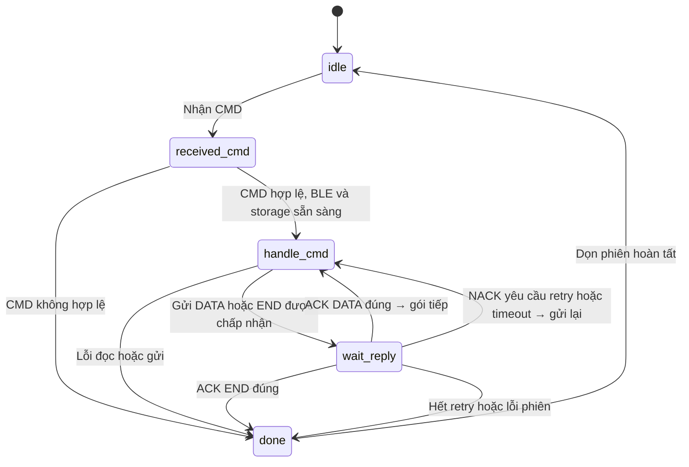
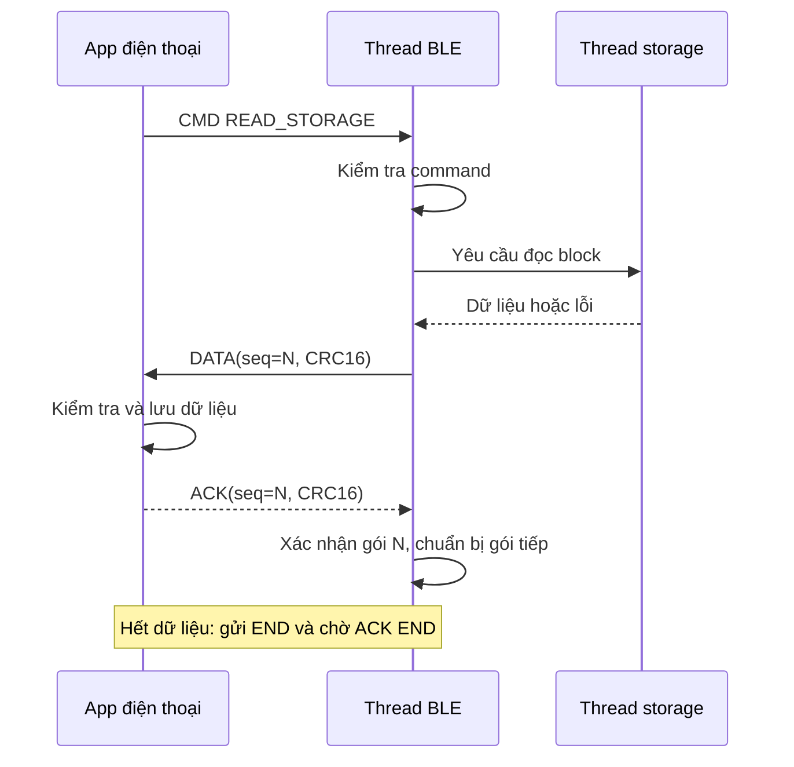

# Thiết kế luồng BLE

Một phiên truyền, một gói chờ ACK. Đây là thiết kế cần implement.

## Chuyển trạng thái



- State trong code có tiền tố `ble_app_`.
- Đang chờ storage: giữ `handle_cmd`. Chưa có ACK/NACK: giữ `wait_reply`.
- Retry chỉ khi còn lượt và TX trước đã hoàn tất; giữ nguyên gói và SEQ.
- Mất kết nối/notify trong phiên → `done`; CMD mới khi bận → BUSY.

## Mỗi state làm gì?

| State | Handler | Công việc |
|---|---|---|
| `idle` | `idle_handler()` | Chờ command |
| `received_cmd` | `received_cmd_handler()` | Kiểm tra command, chiều dài, CRC và điều kiện truyền |
| `handle_cmd` | `handle_cmd_handler()` | Yêu cầu đọc storage; gửi DATA/END hoặc gửi lại gói cũ |
| `wait_reply` | `wait_reply_handler()` | Kiểm tra ACK/NACK đúng CRC, SEQ và phiên; xử lý timeout |
| `done` | `done_handler()` | Dọn tài nguyên, reset cờ rồi về idle |

## Một lần đọc và gửi



## Quy tắc chính

- Callback sao chép RX vào queue/pool có giới hạn; chỉ thread BLE cập nhật FSM.
- Thread ngủ chờ event/deadline; state mới có việc tức thời được xử lý ngay.
- `bt_nus_send() == 0` → `success_send`; callback `.sent` → `TX_DONE`.
- Chỉ ACK từ app mới xác nhận app nhận gói. Không tăng tiến độ khi chỉ có `TX_DONE`.
- App nhận DATA trùng SEQ: không lưu lần nữa, vẫn trả ACK.
- Retry tối đa 5 lần sau lần gửi đầu; timeout cần chọn khi đo thực tế.
- Giữ buffer tới khi storage/TX hoàn tất; giữ gói để retry. Không giải phóng sớm khi hủy phiên.
- Kiểm tra CMD xong mới xét `verified_cmd`; dọn phiên xong mới rời `done`.

## Gói tin

```text
TYPE (1B) | SEQ (2B) | LEN (2B) | PAYLOAD (LEN B) | CRC16 (2B)
```

| TYPE | Giá trị | Payload |
|---|---|---|
| CMD | `0x01` | Mã lệnh; READ_STORAGE = `0x01` |
| DATA | `0x02` | Dữ liệu storage |
| END | `0x05` | Rỗng; SEQ tiếp theo DATA cuối |
| ACK | `0xA0` | Rỗng; SEQ trùng gói xác nhận |
| NACK | `0xA1` | Mã lỗi; SEQ trùng gói bị từ chối |

Little-endian; chiều dài nhận phải bằng `7 + LEN`. Một frame vừa một notification/write.
CRC sai → bỏ gói; bên gửi phục hồi bằng timeout.

CRC-16/IBM-3740: `poly=0x1021`, `init=0xFFFF`, không reflect, `xorout=0`.
Tính trên header + payload; không gồm CRC cuối. `"123456789"` → `0x29B1`.
