# Thiết kế luồng BLE

Luồng hiện tại của `ble_thread.c`: một phiên truyền, một frame chờ ACK. Mutex được truyền qua `p1`, giữ từ lúc kiểm tra storage đến khi xóa hoàn tất hoặc hủy phiên.

## Chuyển trạng thái

Tên state trong code có tiền tố `ble_app_`. Handler thực hiện action trước, sau đó `fsm_change_state()` quyết định state tiếp theo. `done` là cờ báo hết dữ liệu để gửi END; khác với state `ble_app_done` dùng để dọn phiên.

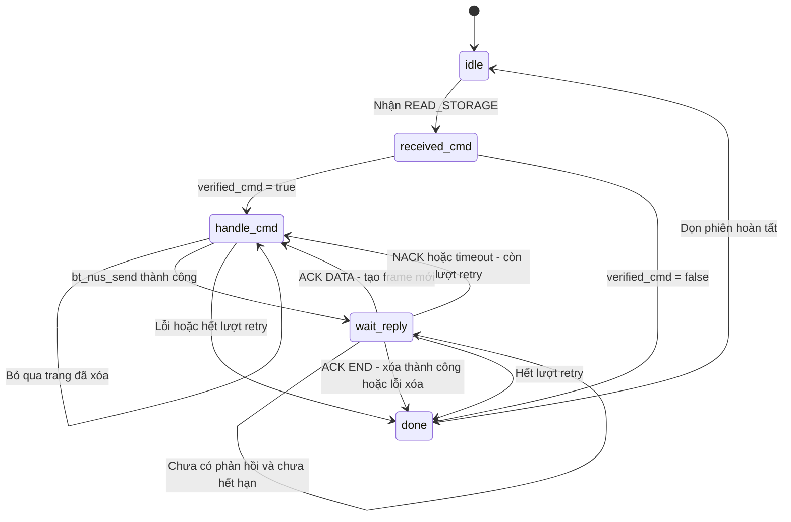

- `failed = true` được ưu tiên: chuyển sang `done` trước khi xét các điều kiện khác.
- Mất kết nối của phiên hiện tại đặt `failed = true`. Lệnh mới khi bận bị bỏ qua và ghi log.
- Callback giải mã và kiểm tra CRC trước khi đưa event vào queue. Vòng lặp BLE thread đối chiếu kết nối, state chờ và SEQ trước khi đặt cờ ACK/NACK.
- Retry giữ nguyên packet, SEQ và vị trí dữ liệu; chỉ ACK DATA mới tăng tiến độ đọc.

## Bảng action-state

| State | Handler | Action | Điều kiện chuyển state |
|---|---|---|---|
| `idle` | `idle_handler()` | Không có action; thread chờ lệnh, cờ được dọn trong done | Có `received_cmd` → `received_cmd`; chưa có → giữ state |
| `received_cmd` | `received_cmd_handler()` | Kiểm tra READ_STORAGE và mutex; lấy khóa bằng K_NO_WAIT; kiểm tra kích thước storage, nhả ngay nếu lỗi; đặt `page_offset = 0`, `page_pos = 2046` | `verified_cmd = true` → `handle_cmd`; ngược lại → `done` |
| `handle_cmd` | `handle_cmd_handler()` | Kiểm tra kết nối, MTU. Frame mới: đọc trang, tạo DATA/END và CRC. Retry: giữ packet và tăng bộ đếm. Gửi BLE, đặt deadline | Gửi thành công → `wait_reply`; bỏ qua trang đã xóa → giữ state; lỗi → `done` |
| `wait_reply` | `wait_reply_handler()` | ACK DATA: tăng vị trí đọc. ACK END: xóa storage khi vẫn giữ mutex. ACK xử lý thành công: tăng SEQ, reset retry và cho phép tạo frame mới. NACK/timeout: giữ frame để retry | ACK DATA hoặc còn lượt retry → `handle_cmd`; ACK END hoặc hết retry → `done`; chưa có phản hồi → giữ state |
| `done` | `done_handler()` | Nhả mutex nếu verified_cmd; nhả reference kết nối; tăng SEQ; reset vị trí, deadline và cờ phiên | Dọn xong → `idle` |

## Lưu đồ giải thuật của handler

Các điểm kết thúc dưới đây là thoát khỏi handler, không dừng thread. Việc chuyển state được thực hiện sau đó bởi FSM.

### `idle_handler()`

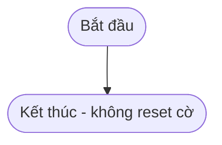

Struct static được khởi tạo bằng 0; `done_handler()` dọn cờ sau mỗi phiên.

### `received_cmd_handler()`

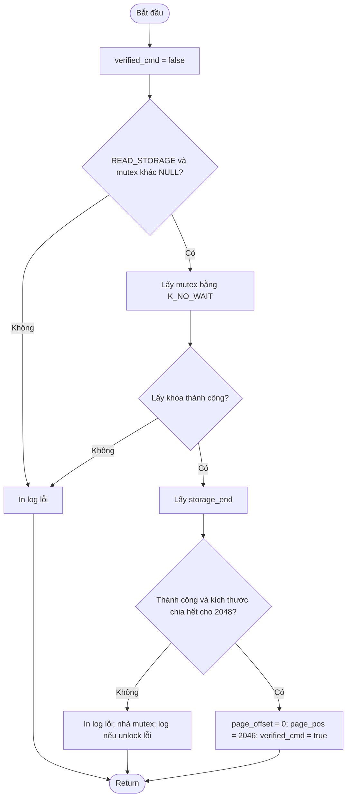

`verified_cmd = true` đồng thời biểu thị phiên hợp lệ đang giữ mutex. Không thêm cờ quản lý khóa.

### `handle_cmd_handler()`

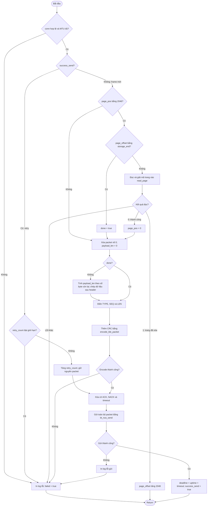

Frame END có `LEN = 0`; frame DATA có tối đa 238 byte dữ liệu, phần chưa dùng được điền 0.

### `wait_reply_handler()`

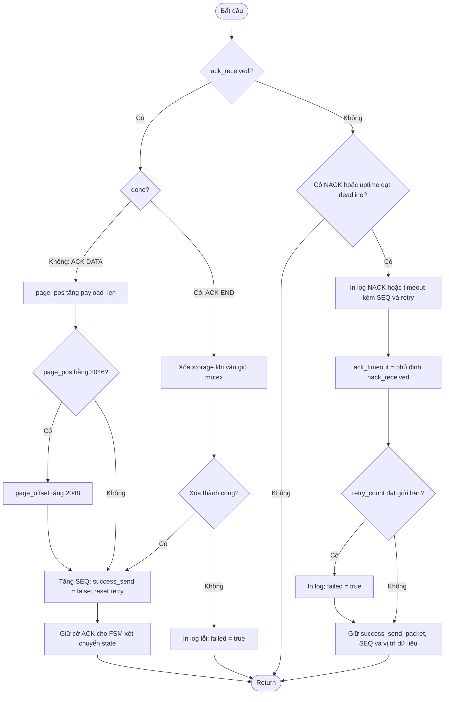

### `done_handler()`

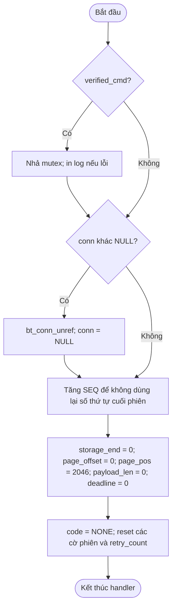

## Một phiên đọc và gửi

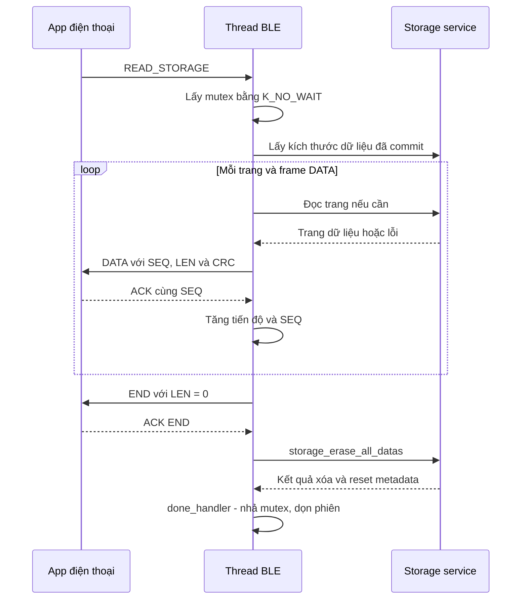

Sơ đồ trên là đường thành công. NACK/timeout gửi lại nguyên frame, tối đa 5 lần sau lần đầu. Lỗi hoặc mất kết nối trước ACK END dẫn tới dọn phiên và nhả khóa, không gọi xóa. Xóa thất bại cũng dọn phiên và nhả khóa; storage chưa được coi là sẵn sàng thu tiếp.

## Mutex và vòng lặp thread

- Nơi tạo thread truyền địa chỉ mutex hợp lệ qua `p1`. Các bên đọc, ghi hoặc xóa storage phải dùng cùng mutex.
- Lấy khóa trước `storage_get_data_size()`, giữ qua đọc trang, gửi BLE, chờ ACK/retry và xóa sau ACK END.
- Mutex NULL hoặc đang bận: log lỗi và kết thúc xác nhận lệnh, không đọc/xóa. Không chờ lấy khóa.
- Kiểm tra storage lỗi sau khi lấy khóa: nhả ngay trong `received_cmd_handler()`.
- Phiên đã xác nhận: `done_handler()` nhả khóa trước khi reset `verified_cmd`, kể cả khi phiên lỗi.
- Mutex không tự dừng cảm biến; bên thu phải phối hợp để tránh buffer đầy trong thời gian BLE giữ khóa.
- Vòng lặp `while (1)`: idle chờ queue bằng `K_FOREVER`; wait_reply chờ đến event hoặc deadline; các state khác dùng `K_NO_WAIT`.
- Sau khi xử lý event, chạy handler rồi gọi `fsm_change_state()`. Khi failed, bỏ qua handler bình thường nhưng vẫn cho done chạy để dọn phiên.

## Event và quy tắc truyền

- Callback kiểm tra frame RX rồi đưa event gồm kết nối, code và SEQ vào queue 4 phần tử; không sao chép nguyên frame RX vào queue.
- Mỗi event giữ một reference kết nối. Enqueue lỗi: callback nhả reference. Xử lý xong: thread nhả reference, trừ khi đã chuyển quyền sở hữu sang phiên.
- ACK/NACK chỉ được ghi nhận cho đúng kết nối, đúng SEQ và khi đang wait_reply. Giữ phản hồi đầu tiên.
- `bt_nus_send() == 0` nghĩa là stack chấp nhận gửi, không phải app đã nhận. `.sent = NULL`; không có event TX_DONE trong luồng này.
- Chỉ ACK DATA tăng vị trí dữ liệu. Retry giữ nguyên packet và SEQ; timeout ACK hiện tại là 2000 ms.
- Bên nhận cần tránh lưu DATA trùng SEQ lần nữa và vẫn trả ACK để phục hồi khi ACK trước bị mất.
- Storage được đọc trực tiếp qua service trong BLE thread; không qua storage thread.
- Trang storage gồm 2046 byte dữ liệu và 2 byte CRC. Trang toàn 0xFF được bỏ qua; lỗi đọc/CRC được thử tối đa 10 lần.
- Log bằng printk tại nhánh lỗi, NACK và timeout. Các trường hợp queue rỗng hoặc trang đã xóa không phải lỗi.
- SEQ tăng sau ACK xử lý thành công và tăng thêm khi dọn phiên; không reset về 0 mỗi phiên.

## Gói tin

### BLE gửi sang app: cố định 244 byte

```text
TYPE (1B) | SEQ (2B) | LEN (1B) | DATA (238B) | CRC16 (2B)
```

| TYPE | Giá trị | LEN và DATA |
|---|---|---|
| DATA | `0x02` | LEN từ 1 đến 238; phần DATA chưa dùng bằng 0 |
| END | `0x05` | LEN = 0; toàn bộ DATA bằng 0 |

CRC tính trên 242 byte đầu, gồm cả phần DATA điền 0. Hai byte CRC ở cuối frame.

### App gửi sang BLE: cố định 5 byte

```text
TYPE (1B) | SEQ (2B) | CRC16 (2B)
```

| TYPE | Giá trị | Ý nghĩa |
|---|---|---|
| READ_STORAGE | `0x01` | Bắt đầu phiên; SEQ của lệnh không dùng để khởi tạo SEQ truyền |
| ACK | `0xA0` | Xác nhận frame cùng SEQ |
| NACK | `0xA1` | Yêu cầu gửi lại frame cùng SEQ; không có payload mã lỗi |

RX phải dài đúng 5 byte; CRC tính trên 3 byte đầu. CRC sai hoặc TYPE không hợp lệ: log và bỏ frame.

SEQ và CRC dùng little-endian. Frame gửi yêu cầu ATT MTU ít nhất 247 byte và app đã đăng ký notification NUS TX.

CRC frame BLE là CRC-16/IBM-3740 (CCITT-FALSE): `poly=0x1021`, `init=0xFFFF`, không reflect, `xorout=0`. CRC trang storage dùng `crc16_ccitt()` với seed `0xFFFF`, khác thuật toán CRC frame BLE.


# Thiết kế luồng storage

Handler chạy trước, FSM xét chuyển state sau. `failed = true` kết thúc thread và giữ buffer, không phải một state mới.

## Chuyển trạng thái

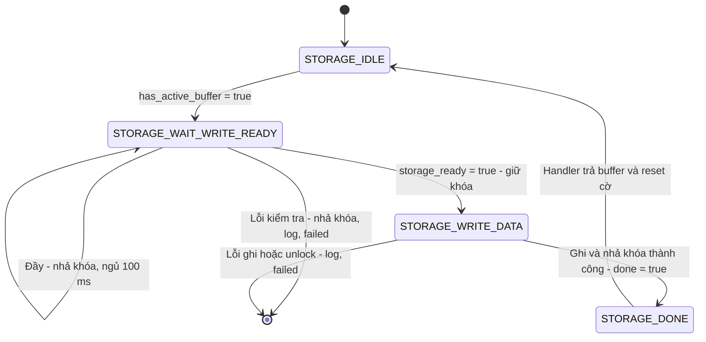

## Lưu đồ giải thuật của handler

Các nút Return chỉ thoát handler. Thread kiểm tra `failed` trước khi gọi `fsm_change_state()`.

### `storage_idle_handler()`

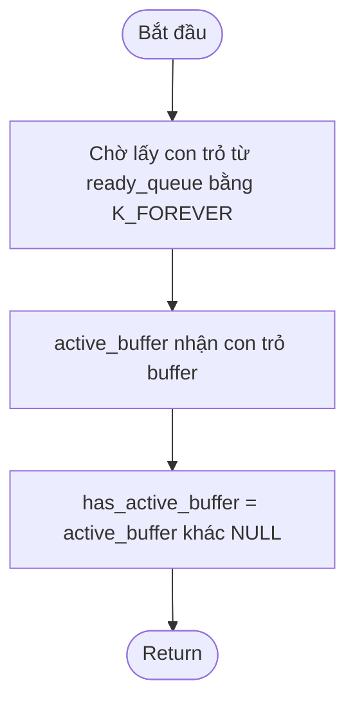

### `storage_wait_write_ready_handler()`

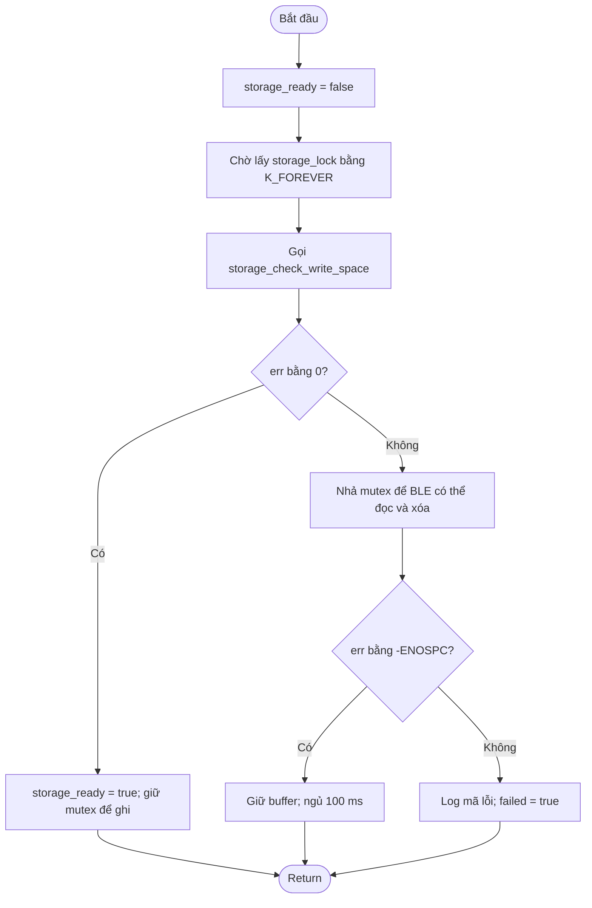

### `storage_write_data_handler()`

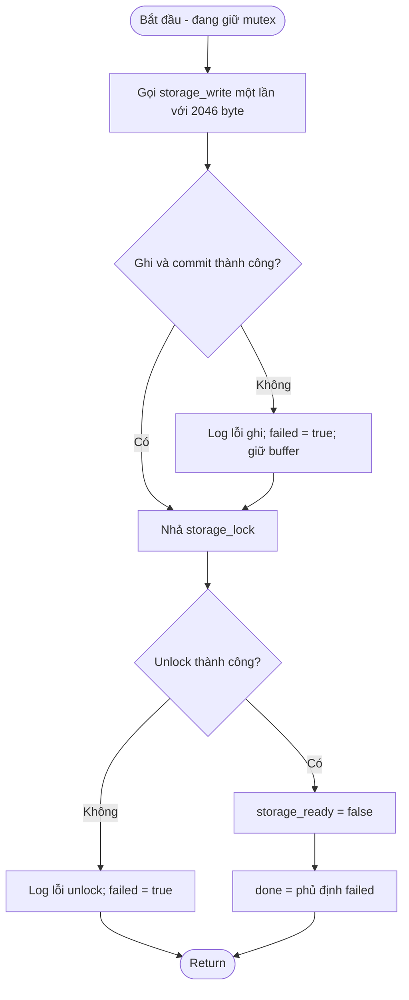

### `storage_done_handler()`

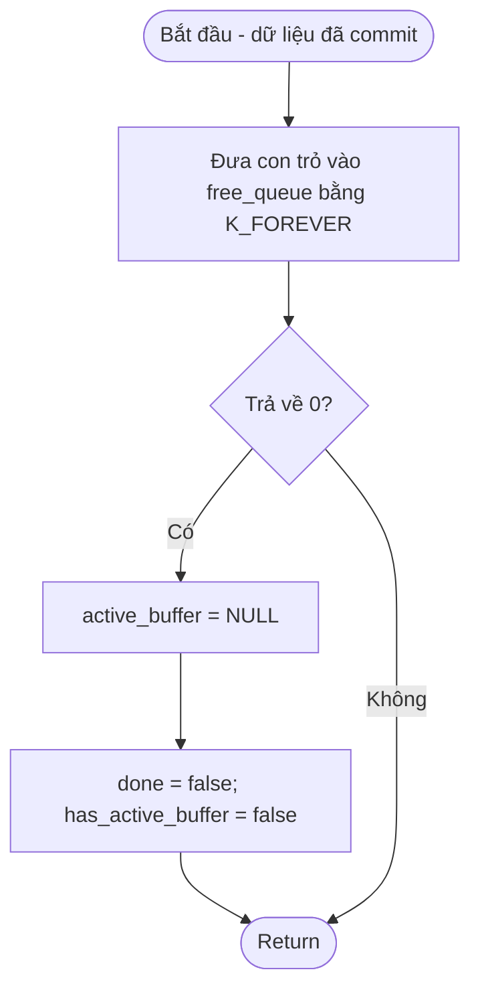

## Thiết kế đề xuất: hai buffer giữa acquisition và storage

Phần này mô tả phương án để review, chưa xác nhận đã triển khai trong code. `acq_tcb` và `storage_tcb` là control block của hai thread trong `main.c`:

| Thread | Nhiệm vụ | Quyền sở hữu buffer |
|---|---|---|
| Thread thu, tạo bằng `acq_tcb` | Đọc cảm biến và đóng gói dữ liệu vào buffer | Chỉ ghi buffer đã lấy từ `free_queue` |
| Thread lưu, tạo bằng `storage_tcb` | Lấy buffer đầy và ghi xuống storage | Giữ buffer từ lúc lấy khỏi `ready_queue` đến khi ghi và commit hoàn tất |

### Cấp phát và truyền tham số

- Khai báo hai buffer A/B bằng `static` tại phạm vi file trong `main.c`. Buffer tồn tại suốt chương trình, không dùng heap.
- Mỗi buffer có `STORAGE_BLOCK_DATA_SIZE = 2046` byte dữ liệu. Storage service tự thêm 2 byte CRC để tạo trang Flash 2048 byte.
- Tạo `free_queue` và `ready_queue`, mỗi queue chứa tối đa hai con trỏ `uint8_t *`. Queue sao chép con trỏ, không sao chép nội dung buffer.
- Trước khi khởi chạy thread, đưa con trỏ A và B vào `free_queue`. `ready_queue` ban đầu rỗng.
- Tham số hiện tại: acquisition nhận `p1 = &free_queue`, `p2 = &ready_queue`; storage nhận `p1 = &storage_lock`, `p2 = &free_queue`, `p3 = &ready_queue`. BLE nhận `p1 = &storage_lock`.
- Việc seed free_queue và hoàn thiện bàn giao từ acquisition vẫn là điều kiện tích hợp cần kiểm tra; khai báo queue không tự đưa buffer vào queue.

### Nội dung queue

| Queue | Nội dung | Bên đưa vào | Bên lấy ra |
|---|---|---|---|
| `free_queue` | Con trỏ buffer rảnh, được phép ghi đè dữ liệu cũ | Main khởi tạo; storage trả buffer sau khi ghi thành công | Acquisition |
| `ready_queue` | Con trỏ buffer đầy, đang chờ ghi xuống storage | Acquisition | Storage |

Buffer rảnh không có nghĩa là toàn bộ byte bằng 0. Acquisition điền đủ dữ liệu mới nên không cần xóa buffer trước mỗi lần dùng.

### Luồng bàn giao buffer

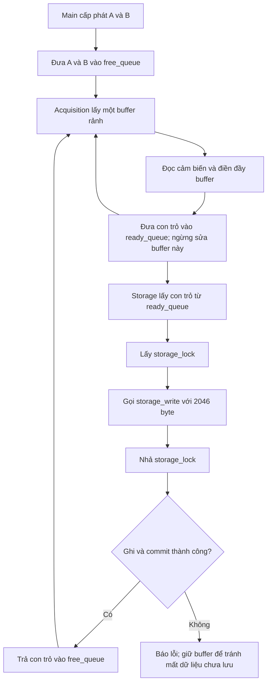

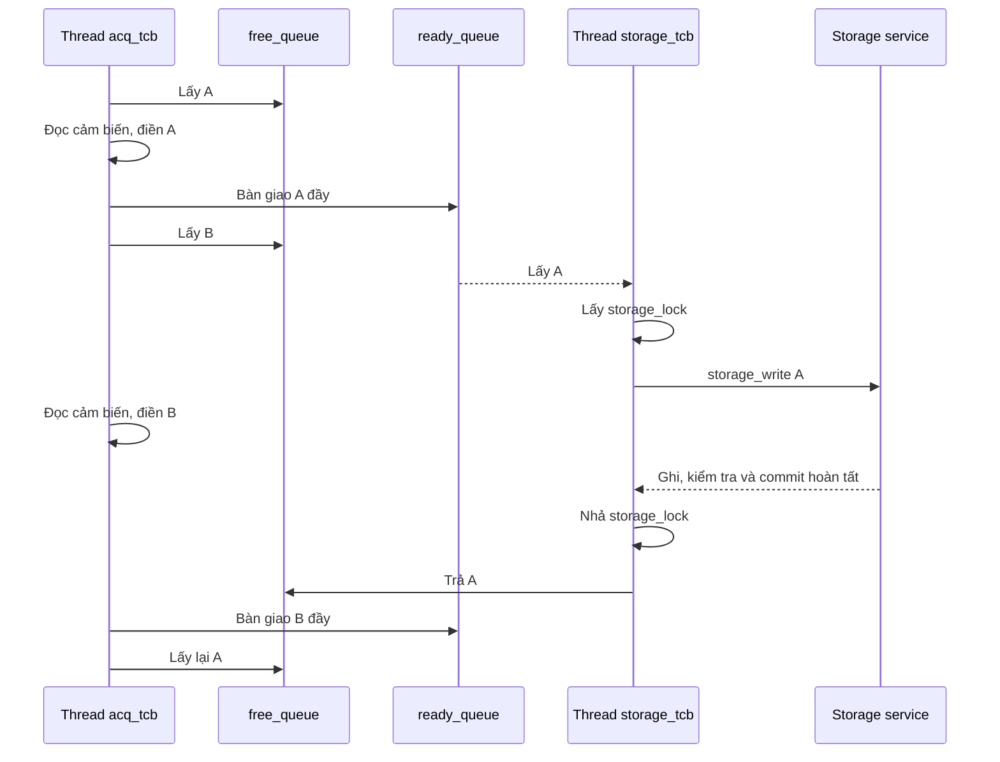

### Quy tắc sở hữu và xử lý lỗi

- Một buffer chỉ ở một nơi: trong free_queue, thuộc acquisition, trong ready_queue hoặc thuộc storage. Không đưa cùng con trỏ vào queue hai lần.
- Acquisition không sửa buffer sau khi bàn giao; storage không trả buffer trước khi thao tác ghi đồng bộ kết thúc.
- Không cần mutex riêng cho dữ liệu buffer nếu tuân thủ quyền sở hữu. Mutex storage bảo vệ Flash và metadata giữa storage thread và BLE thread.
- Khi cả hai buffer đang bận, acquisition không được ghi đè. Cần chọn chính sách quá tải: chờ nếu cảm biến cho phép, dừng thu hoặc báo mất dữ liệu. Hai buffer không bảo đảm thu liên tục nếu ghi Flash quá chậm.
- Ghi lỗi: không tự trả buffer như thể đã lưu thành công. Giữ dữ liệu, báo lỗi và quyết định retry hoặc dừng thu.
- `storage_write()` hiện chỉ nhận đúng 2046 byte. Buffer cuối chưa đầy cần quy tắc đóng gói/padding và biểu diễn độ dài hợp lệ trước khi triển khai; không gửi độ dài tùy ý vào storage service.
- Hai buffer cần 4092 byte RAM dữ liệu, chưa tính queue và đối tượng kernel. Không có bản sao payload trong queue; storage service hiện vẫn dùng page_buffer nội bộ để thêm CRC và xác minh ghi.

### Phối hợp trước phiên BLE

```text
Dừng acquisition → bàn giao phần cuối theo quy tắc đóng gói
→ storage ghi hết dữ liệu đang chờ và báo flush hoàn tất
→ BLE lấy storage_lock → đọc/gửi → ACK END → xóa storage
→ BLE nhả khóa → cho phép bắt đầu lần thu tiếp theo
```

Không chỉ kiểm tra ready_queue rỗng: storage có thể đang giữ buffer và chưa ghi xong. Cần xác nhận flush/barrier sau khi acquisition ngừng bàn giao. Mutex ngăn truy cập Flash đồng thời nhưng không tự dừng acquisition hoặc loại bỏ buffer cũ đang chờ; nếu bỏ qua bước flush, dữ liệu phiên cũ có thể được ghi lại sau khi BLE xóa.
