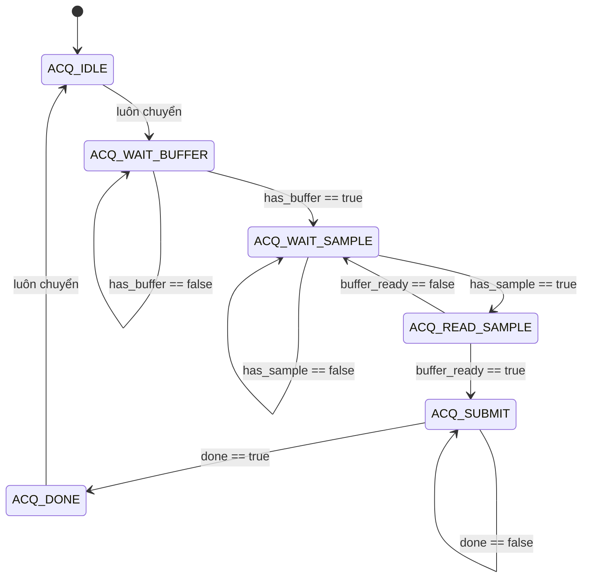
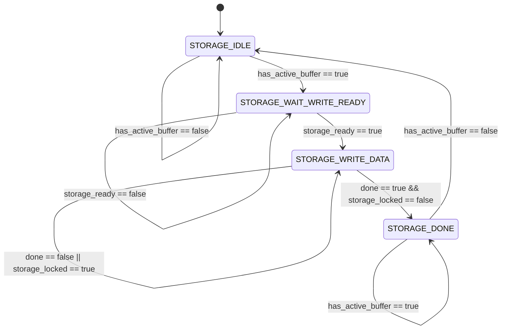
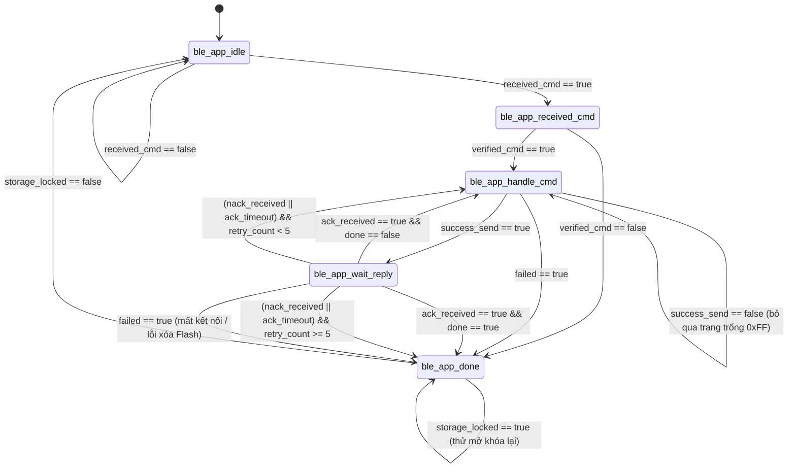

# Tài liệu Thiết kế Tầng Ứng dụng (Applications) — Chest Node Firmware

Tài liệu này mô tả chi tiết kiến trúc đa luồng, lưu đồ chuyển trạng thái (FSM), quy tắc đồng bộ tài nguyên, định dạng khung dữ liệu, cùng toàn bộ hằng số, biến, cờ và hàm thuộc thư mục `chest_node/applications`. Tài liệu không chứa mã nguồn, phục vụ làm đặc tả kỹ thuật cho đội firmware triển khai, rà soát và bảo trì.

---

## 1. Tổng quan Hệ thống & Tài nguyên Dùng chung (`app_api`)

Hệ thống tầng ứng dụng chạy trên Zephyr RTOS, gồm **3 luồng (thread)** hoạt động độc lập theo mô hình Máy trạng thái hữu hạn (FSM), giao tiếp và đồng bộ thông qua **2 hàng đợi con trỏ buffer** (double-buffering) và **1 mutex bảo vệ Flash**.

### 1.1. Bảng phân bổ luồng (Threads)

Trong Zephyr, giá trị ưu tiên **nhỏ hơn có độ ưu tiên cao hơn**.

| Luồng | Hàm thực thi | Stack tĩnh | Kích thước Stack | Độ ưu tiên | Tham số truyền vào (`p1`, `p2`, `p3`) | Vai trò chính |
| :--- | :--- | :--- | :---: | :---: | :--- | :--- |
| Acquisition | `acquisition_thread` | `acq_stack` | 1024 byte | **4** (Cao nhất) | `free_queue`, `ready_queue`, `NULL` | Thu mẫu ECG (AD8232 DMA) và IMU (BMI323), đóng gói 114 byte, nạp đầy buffer 2046 byte. |
| BLE | `ble_thread` | `ble_stack` | 2048 byte | **5** (Trung bình) | `storage_lock`, `NULL`, `NULL` | Nhận lệnh BLE NUS, đọc dữ liệu từ Flash, chia khung 244 byte gửi qua BLE kèm ACK/NACK và xóa Flash khi xong. |
| Storage | `storage_thread` | `storage_stack` | 1536 byte | **6** (Thấp nhất) | `storage_lock`, `free_queue`, `ready_queue` | Nhận buffer đầy từ Acquisition, xin khóa Flash, ghi trang dữ liệu xuống Flash rồi trả buffer rỗng lại. |

### 1.2. Bảng hằng số và biến/tài nguyên dùng chung (`app_api.c`)

| Tên định danh | Phân loại / Kiểu | Giá trị / Kích thước | Quyền sở hữu & Vai trò |
| :--- | :--- | :--- | :--- |
| `ACQ_STACK_SIZE` | Hằng số | `1024` byte | Kích thước stack cho `acquisition_thread`. |
| `STORAGE_STACK_SIZE` | Hằng số | `1536` byte | Kích thước stack cho `storage_thread`. |
| `BLE_STACK_SIZE` | Hằng số | `2048` byte | Kích thước stack cho `ble_thread`. |
| `ACQ_PRIORITY` | Hằng số | `4` | Mức ưu tiên của `acquisition_thread`. |
| `BLE_APP_PRIORITY` | Hằng số | `5` | Mức ưu tiên của `ble_thread`. |
| `STORAGE_PRIORITY` | Hằng số | `6` | Mức ưu tiên của `storage_thread`. |
| `acq_stack`, `storage_stack`, `ble_stack` | Vùng nhớ stack tĩnh | Theo kích thước trên | Vùng nhớ stack riêng cho từng luồng, cấp phát tĩnh khi biên dịch. |
| `acq_tcb`, `storage_tcb`, `ble_tcb` | `static struct k_thread` | 3 khối TCB | Khối điều khiển luồng của kernel Zephyr cho 3 luồng. |
| `storage_lock` | `K_MUTEX` | Khởi tạo mở khóa | Mutex tuần tự hóa mọi truy cập dịch vụ Storage/Flash (kiểm tra dung lượng, ghi, đọc, xóa) giữa `storage_thread` và `ble_thread`. |
| `buffer_a`, `buffer_b` | `static uint8_t[]` | `STORAGE_BLOCK_DATA_SIZE` (2046 byte mỗi buffer) | Hai vùng đệm tĩnh dùng luân phiên (ping-pong / double-buffering) lưu dữ liệu ECG + BMI323 trước khi ghi xuống Flash. |
| `free_queue` | `K_MSGQ` | Tối đa 2 phần tử, mỗi phần tử là con trỏ `uint8_t *` | Hàng đợi chứa con trỏ các buffer **trống** chờ `acquisition_thread` lấy để ghi dữ liệu mới. |
| `ready_queue` | `K_MSGQ` | Tối đa 2 phần tử, mỗi phần tử là con trỏ `uint8_t *` | Hàng đợi chứa con trỏ các buffer **đã đầy** do `acquisition_thread` đẩy sang cho `storage_thread` ghi xuống Flash. |
| `system_initialized` | `static bool` | Khởi tạo `false` | Cờ chống khởi tạo lặp lại trong `system_init()`. Chỉ luồng `main` được gọi. |
| `system_started` | `static bool` | Khởi tạo `false` | Cờ chống khởi chạy các luồng lặp lại trong `system_run()`. Chỉ luồng `main` được gọi. |

### 1.3. Quy tắc đồng bộ và chuyển giao quyền sở hữu liên luồng

1. **Quyền sở hữu buffer đôi (`buffer_a`, `buffer_b`):**
   - Các hàng đợi `free_queue` và `ready_queue` chỉ sao chép **con trỏ**, không sao chép 2046 byte dữ liệu.
   - Tại bất kỳ thời điểm nào, mỗi buffer chỉ thuộc về đúng một bên: nằm trong `free_queue`, thuộc `acquisition_thread` (đang điền dữ liệu), nằm trong `ready_queue`, hoặc thuộc `storage_thread` (đang ghi xuống Flash).
   - Khi khởi tạo (`system_init`), cả `buffer_a` và `buffer_b` được nạp sẵn vào `free_queue` đúng một lần.
   - Nếu `storage_thread` chưa kịp trả buffer (ví dụ Flash đầy hoặc BLE đang giữ `storage_lock`), `acquisition_thread` sẽ tạm dừng DMA AD8232 trước khi chờ vô hạn trên `free_queue`, chấp nhận tạo khoảng trống dữ liệu nhưng không bao giờ ghi đè buffer đang thuộc Storage.

2. **Quy tắc dùng chung mutex `storage_lock`:**
   - Mọi thao tác đọc, ghi, kiểm tra dung lượng, lấy kích thước dữ liệu và xóa Flash đều phải nắm giữ `storage_lock`.
   - `storage_thread` khóa mutex theo chu kỳ ngắn (kiểm tra dung lượng → ghi 1 trang 2048 byte → mở khóa ngay) để không chặn BLE quá lâu.
   - `ble_thread` khóa mutex **xuyên suốt cả phiên truyền dữ liệu** (từ lúc xác thực lệnh `READ_STORAGE`, đọc toàn bộ trang, truyền BLE kèm retry, cho đến khi xóa xong toàn bộ Flash sau `END ACK`), đảm bảo dữ liệu không bị thay đổi giữa phiên truyền. Trong lúc này, `storage_thread` sẽ chờ ở bước xin khóa.

3. **Quy tắc quản lý tham chiếu kết nối BLE (`bt_conn`):**
   - Các callback của BLE stack (`rx_received`, `rx_disconnected`) chạy trong ngữ cảnh hệ thống BLE, **không được** sửa trực tiếp cờ FSM của `ble_thread`.
   - Khi đẩy sự kiện vào `ble_rx_queue`, hàm `queue_rx_event` tăng bộ đếm tham chiếu bằng `bt_conn_ref`. Nếu hàng đợi đầy, hàm phải gọi ngay `bt_conn_unref`.
   - Khi `ble_thread` lấy sự kiện ra: nếu bắt đầu phiên mới ở trạng thái `ble_app_idle`, quyền sở hữu tham chiếu được chuyển sang `transfer.conn`; mọi trường hợp khác đều phải giải phóng bằng `bt_conn_unref`. Khi kết thúc phiên tại `done_handler`, `transfer.conn` được giải phóng bằng `bt_conn_unref` nhưng không chủ động ngắt kết nối BLE.

### 1.4. Mô tả chi tiết các hàm trong `app_api`

#### `system_init` *(Public — khai báo trong `app_api.h`)*
- **Mục đích:** Khởi tạo tuần tự các phân hệ tầng ứng dụng, nạp bể buffer đôi và khởi tạo hệ thống theo dõi (`tracking_system`). Chỉ được gọi một lần từ luồng `main` trước khi chạy các luồng.
- **Tham số & Giá trị trả về:** Không có tham số. Trả về `0` nếu thành công; `-EALREADY` nếu đã khởi tạo trước đó; hoặc mã lỗi âm từ phân hệ con bị lỗi.
- **Biến/Cờ tác động:** `system_initialized`, `free_queue`, `buffer_a`, `buffer_b`.
- **Hành vi chi tiết:**
  1. Kiểm tra `system_initialized`; nếu đã là `true` thì trả về `-EALREADY`.
  2. Gọi `storage_thread_init()` để khôi phục và khởi tạo dịch vụ Flash trước tiên.
  3. Gọi `acquisition_init()` để kiểm tra sẵn sàng AD8232 và cấu hình BMI323.
  4. Gọi `signal_mux_init()` để chọn ngõ vào điện cực ECG và tắt tín hiệu chuẩn.
  5. Gọi `ble_thread_init()` để khởi tạo BLE NUS (lưu ý hiện hàm này trả về `void`, chưa lan truyền lỗi).
  6. Đưa lần lượt con trỏ `buffer_a` và `buffer_b` vào `free_queue` theo chế độ không chờ (`K_NO_WAIT`).
  7. Đọc kích thước dữ liệu hiện có trong Flash qua `storage_get_data_size()` và gọi macro `TRK_INIT` truyền `free_queue`, `ready_queue` và dung lượng Flash ban đầu.
  8. Đặt `system_initialized = true` và trả về `0`.
- **Xử lý lỗi/biên:** Nếu bước nào thất bại thì trả về mã lỗi ngay lập tức và giữ `system_initialized = false`. Riêng nếu đưa `buffer_b` vào `free_queue` lỗi, hàm xóa sạch `free_queue` (`k_msgq_purge`) trước khi trả lỗi.

#### `system_run` *(Public — khai báo trong `app_api.h`)*
- **Mục đích:** Tạo và khởi chạy đồng thời 3 luồng làm việc (`storage_thread`, `acquisition_thread`, `ble_thread`) và bật hệ thống tracking.
- **Tham số & Giá trị trả về:** Không có tham số, không trả về giá trị (`void`).
- **Biến/Cờ tác động:** `system_initialized`, `system_started`, `storage_tcb`, `acq_tcb`, `ble_tcb`.
- **Hành vi chi tiết:**
  1. Nếu chưa khởi tạo (`!system_initialized`) hoặc đã chạy (`system_started`) thì thoát ngay.
  2. Đặt `system_started = true`.
  3. Tạo 3 luồng ở trạng thái chờ khởi chạy (`K_FOREVER`): `storage_tcb`, `acq_tcb`, `ble_tcb` với stack, ưu tiên và tham số tương ứng.
  4. Khởi chạy lần lượt: `storage_tcb`, `acq_tcb`, `ble_tcb` (thứ tự khởi chạy không đảm bảo thứ tự hoàn tất vòng đầu của từng luồng).
  5. Gọi macro `TRK_START()`.
- **Xử lý lỗi/biên:** Ngăn chặn việc gọi `system_run()` nhiều lần hoặc gọi khi `system_init()` thất bại.

---

## 2. Acquisition Thread (`acq_thread`)

Luồng thu thập dữ liệu chịu trách nhiệm lấy mẫu ECG 500 Hz qua DMA (mỗi khối 50 mẫu ≈ 100 ms), đọc kèm 1 mẫu IMU 6 trục (BMI323), đóng gói thành gói 114 byte và ghi nối tiếp (không chèn đệm) vào các buffer 2046 byte để chuyển sang Storage.

### 2.1. Sơ đồ chuyển trạng thái (FSM)

Trong mỗi vòng lặp vô hạn của `acquisition_thread`, luồng gọi `fsm_handle_state()` để thực thi hành động và cập nhật cờ, sau đó gọi `fsm_change_state()` để đánh giá chuyển trạng thái.

### 2.2. Định dạng gói dữ liệu 114 byte & cơ chế chia gói qua ranh giới buffer

- **Cấu trúc gói (`ACQ_PACKET_SIZE = 114` byte):**
  - Byte `0`: Header cố định `0x00` (`ACQ_PACKET_HEADER`).
  - Byte `1..100` (100 byte): 50 mẫu ECG kiểu số nguyên có dấu 16-bit, thứ tự byte little-endian (`int16_t` đã trừ mức nền `ECG_BASELINE_ADC = 1877`).
  - Byte `101..112` (12 byte): 6 trục cảm biến BMI323 theo thứ tự `accel_x`, `accel_y`, `accel_z`, `gyro_x`, `gyro_y`, `gyro_z`, mỗi trục 16-bit có dấu little-endian. Nếu đọc BMI lỗi hoặc thiết bị không sẵn sàng, cả 6 trục được điền giá trị sentinel `INT16_MIN` (`-32768`) để giữ nguyên cấu trúc khung.
  - Byte `113`: Tail cố định `0x99` (`ACQ_PACKET_TAIL`).
- **Cơ chế cắt gói qua ranh giới 2046 byte:**
  - Vì `2046` không chia hết cho `114` (`2046 = 17 × 114 + 108`), một gói 114 byte có thể bị tách làm hai phần nằm trên hai buffer liên tiếp mà **không chèn byte đệm**.
  - Phần vừa khớp được sao chép vào cuối `active_buffer` hiện tại; số byte còn lại được giữ nguyên trong mảng `acq_resources.packet` và theo dõi bởi `packet_remaining`.
  - Khi nhận được `active_buffer` mới tại `wait_buffer_handler()`, hàm `copy_pending_packet()` chép nốt phần dư vào đầu buffer mới trước khi thu khối ECG tiếp theo.

### 2.3. Bảng hằng số, trạng thái, biến và cờ (`acq_thread.c`)

#### Hằng số & Thiết bị

| Tên định danh | Loại / Kiểu | Giá trị | Ý nghĩa |
| :--- | :--- | :--- | :--- |
| `ACQ_PACKET_HEADER` | Hằng số | `0x00` | Byte đánh dấu đầu gói dữ liệu 114 byte. |
| `ACQ_PACKET_TAIL` | Hằng số | `0x99` | Byte đánh dấu cuối gói dữ liệu 114 byte. |
| `ACQ_ECG_SAMPLES` | Hằng số | `50` | Số mẫu ECG trong mỗi khối DMA và trong mỗi gói. |
| `ACQ_BMI_AXES` | Hằng số | `6` | Số trục dữ liệu IMU (3 gia tốc + 3 con quay hồi chuyển). |
| `ACQ_PACKET_SIZE` | Hằng số | `114` | Tổng kích thước một gói dữ liệu (1 + 100 + 12 + 1 byte). |
| `ECG_BASELINE_ADC` | Hằng số | `1877` | Giá trị ADC nền danh định (tương ứng ~1,65 V) dùng để trừ DC khỏi mẫu ECG thô. |
| `ad8232_dev` | `static const struct device *const` | Devicetree node `ad8232` | Con trỏ thiết bị cảm biến ECG AD8232 (bắt buộc sẵn sàng). |
| `bmi323_dev` | `static const struct device *const` | Devicetree node `bmi323` | Con trỏ thiết bị cảm biến IMU BMI323 (tùy chọn). |

#### Enum trạng thái (`enum acquisition_state`)

| Trạng thái | Giá trị | Ý nghĩa |
| :--- | :---: | :--- |
| `ACQ_IDLE` | `0` | Trạng thái khởi đầu chu kỳ mới; chuyển ngay sang xin buffer. |
| `ACQ_WAIT_BUFFER` | `1` | Lấy một buffer trống từ `free_queue` và chép nốt phần gói dư (nếu có). |
| `ACQ_WAIT_SAMPLE` | `2` | Đảm bảo DMA ECG đang chạy và chờ nhận đủ 1 khối 50 mẫu từ AD8232. |
| `ACQ_READ_SAMPLE` | `3` | Xử lý mẫu ECG, trả buffer DMA, đọc BMI323, đóng gói 114 byte và chép vào buffer lưu trữ. |
| `ACQ_SUBMIT` | `4` | Đẩy `active_buffer` đã đầy 2046 byte sang `ready_queue` cho Storage. |
| `ACQ_DONE` | `5` | Hoàn tất bàn giao buffer, xóa quyền sở hữu và reset cờ cho chu kỳ tiếp theo. |

#### Cấu trúc cờ điều khiển (`acq_app_flags`)

| Trường | Kiểu | Khởi tạo | Vai trò |
| :--- | :--- | :---: | :--- |
| `current_state` | `uint8_t` | `ACQ_IDLE` | Trạng thái hiện tại của FSM Acquisition. |
| `has_buffer` | `bool` | `false` | `true` khi đã sở hữu `active_buffer` hợp lệ. |
| `has_sample` | `bool` | `false` | `true` khi đang giữ một buffer DMA ECG đã hoàn tất cần xử lý. |
| `buffer_ready` | `bool` | `false` | `true` khi `write_pos == STORAGE_BLOCK_DATA_SIZE` (buffer 2046 byte đã đầy). |
| `done` | `bool` | `false` | `true` khi đã đẩy thành công con trỏ `active_buffer` vào `ready_queue`. |

#### Cấu trúc tài nguyên (`acq_resources`)

| Trường | Kiểu | Vai trò |
| :--- | :--- | :--- |
| `free_queue` | `struct k_msgq *` | Con trỏ tới hàng đợi buffer trống nhận từ `app_api`. |
| `ready_queue` | `struct k_msgq *` | Con trỏ tới hàng đợi buffer đầy gửi sang Storage. |
| `active_buffer` | `uint8_t *` | Con trỏ tới buffer 2046 byte đang được Acquisition sở hữu để ghi. |
| `write_pos` | `size_t` | Vị trí byte kế tiếp sẽ ghi vào `active_buffer` (`0..2046`). |
| `ecg_buffer` | `struct ad8232_buffer` | Bộ mô tả buffer DMA ECG hiện tại (gồm `samples` và `count`), được giữ cho tới khi giải phóng thành công. |
| `packet` | `uint8_t[114]` | Bộ đệm lắp ráp gói 114 byte và giữ phần dư khi gói cắt ngang ranh giới 2046 byte. |
| `packet_remaining` | `uint8_t` | Số byte còn lại trong `packet` chưa được chép vào `active_buffer`. |
| `ecg_copied` | `bool` | Đánh dấu 50 mẫu ECG đã được chép vào `packet`, tránh trừ baseline lặp lại nếu bước trả buffer DMA phải thử lại. |
| `stream_running` | `bool` | Theo dõi trạng thái đang chạy của luồng DMA AD8232. |

### 2.4. Mô tả chi tiết các hàm trong `acq_thread`

#### `acquisition_init` *(Public — `acq_thread.h`)*
- **Mục đích:** Kiểm tra sẵn sàng phần cứng cảm biến trước khi tạo luồng.
- **Tham số & Giá trị trả về:** Không tham số. Trả về `0` nếu AD8232 sẵn sàng; `-ENODEV` nếu AD8232 chưa sẵn sàng.
- **Biến/Cờ tác động:** Đọc `ad8232_dev`, `bmi323_dev`.
- **Hành vi chi tiết:**
  1. Kiểm tra `device_is_ready(ad8232_dev)`; nếu không sẵn sàng thì trả về `-ENODEV`.
  2. Kiểm tra `device_is_ready(bmi323_dev)`. Nếu không sẵn sàng thì chỉ in cảnh báo và vẫn tiếp tục (BMI là tùy chọn, không được làm hỏng luồng ECG).
  3. Nếu BMI sẵn sàng, gọi `bmi323_set_data_ready_callback(bmi323_dev, NULL)` để chạy theo chế độ polling; nếu lỗi thì in cảnh báo nhưng vẫn trả về `0`.
- **Xử lý lỗi/biên:** Lỗi AD8232 là lỗi nghiêm trọng (dừng init); lỗi BMI được bỏ qua mềm để bảo toàn thu ECG.

#### `acquisition_thread` *(Public — `acq_thread.h`)*
- **Mục đích:** Điểm vào (entry point) của luồng Acquisition trong Zephyr.
- **Tham số & Giá trị trả về:** `p1` = `free_queue`, `p2` = `ready_queue`, `p3` không dùng. Không trả về (`void`).
- **Biến/Cờ tác động:** `acq_resources.free_queue`, `acq_resources.ready_queue`.
- **Hành vi chi tiết:**
  1. Gán `p1`, `p2` vào `acq_resources`.
  2. Nếu `p1 == NULL` hoặc `p2 == NULL`, in lỗi và thoát luồng.
  3. Vào vòng lặp vô hạn: gọi `fsm_handle_state()` rồi gọi `fsm_change_state()`.
- **Xử lý lỗi/biên:** Bảo vệ chống con trỏ hàng đợi rỗng trước khi vào vòng lặp FSM.

#### `fsm_handle_state` *(Static)*
- **Mục đích:** Điều phối thực thi hàm handler tương ứng với `acq_app_flags.current_state` (không tự đổi trạng thái).
- **Tham số & Giá trị trả về:** Không tham số, `void`.
- **Biến/Cờ tác động:** Đọc `acq_app_flags.current_state`; cập nhật tracking qua `TRK_SET_ACQ_STATE`.
- **Hành vi chi tiết:** Rẽ nhánh theo `current_state` để gọi `idle_handler`, `wait_buffer_handler`, `wait_sample_handler`, `read_sample_handler`, `submit_handler`, hoặc `done_handler`. Sau khi gọi xong cập nhật trạng thái vào tracking.
- **Xử lý lỗi/biên:** Nếu `current_state` nằm ngoài các giá trị hợp lệ thì in thông báo lỗi.

#### `fsm_change_state` *(Static)*
- **Mục đích:** Đánh giá các cờ kết quả từ handler vừa chạy để cập nhật `acq_app_flags.current_state`.
- **Tham số & Giá trị trả về:** Không tham số, `void`.
- **Biến/Cờ tác động:** Đọc `has_buffer`, `has_sample`, `buffer_ready`, `done`; ghi `current_state`; gọi `TRK_SET_ACQ_STATE`.
- **Hành vi chi tiết:** Thực hiện đúng quy tắc chuyển trạng thái như sơ đồ mục 2.1.
- **Xử lý lỗi/biên:** Nếu trạng thái không hợp lệ thì in thông báo lỗi và giữ nguyên.

#### `idle_handler` *(Static)*
- **Mục đích:** Trạng thái chờ trung gian đầu chu kỳ (không thực hiện tác vụ).
- **Tham số & Giá trị trả về:** Không tham số, `void`.
- **Biến/Cờ tác động:** Không.

#### `wait_buffer_handler` *(Static)*
- **Mục đích:** Lấy một buffer trống 2046 byte từ `free_queue` nếu chưa có, đồng thời chép phần dư của gói trước vào đầu buffer mới.
- **Tham số & Giá trị trả về:** Không tham số, `void`.
- **Biến/Cờ tác động:** `has_buffer`, `buffer_ready`, `active_buffer`, `write_pos`, `stream_running`, `packet_remaining`.
- **Hành vi chi tiết:**
  1. Đặt `has_buffer = false`.
  2. Nếu `active_buffer == NULL`:
     - Thử lấy buffer ngay không chờ (`k_msgq_get` với `K_NO_WAIT`) để không làm gián đoạn DMA.
     - Nếu không có sẵn buffer trống: nếu DMA đang chạy (`stream_running == true`), ghi nhận mất mẫu qua `TRK_INC_ACQ_DROP()`, phát sự kiện `TRK_EVENT("ACQ", "WRN", "DMA_PAUSE_NO_BUF", 1)`, rồi gọi `stop_ecg_stream()`. Sau đó chờ vô hạn (`K_FOREVER`) trên `free_queue`.
     - Khi có buffer hợp lệ: đặt `write_pos = 0`, `buffer_ready = false`, và gọi `copy_pending_packet()` để chép nốt phần gói bị tách từ chu kỳ trước (nếu có).
  3. Đặt `has_buffer = true`.
- **Xử lý lỗi/biên:** Nếu dừng DMA lỗi thì ngủ 10 ms và quay lại (giữ `has_buffer = false` để thử lại). Nếu `k_msgq_get` lỗi hoặc nhận con trỏ `NULL` thì in lỗi và quay lại.

#### `wait_sample_handler` *(Static)*
- **Mục đích:** Bảo đảm luồng DMA ECG đang hoạt động và chờ nhận đủ một khối 50 mẫu ECG.
- **Tham số & Giá trị trả về:** Không tham số, `void`.
- **Biến/Cờ tác động:** `has_sample`, `ecg_buffer`, `stream_running`, `ecg_copied`.
- **Hành vi chi tiết:**
  1. Đặt `has_sample = false`.
  2. Nếu `ecg_buffer.samples != NULL` (tức buffer DMA trước đó chưa được giải phóng thành công), đặt ngay `has_sample = true` và thoát để `read_sample_handler` thử giải phóng lại.
  3. Nếu `!stream_running`, gọi `ad8232_start()`; thành công thì đặt `stream_running = true`.
  4. Gọi `ad8232_buffer_get()` với thời gian chờ `K_FOREVER` (khoảng 100 ms ở 500 Hz).
  5. Khi nhận thành công, đặt `ecg_copied = false` và `has_sample = true`.
- **Xử lý lỗi/biên:** Nếu `ad8232_start()` lỗi thì in lỗi, ngủ 10 ms và thoát. Nếu `ad8232_buffer_get()` lỗi thì in lỗi, gọi `stop_ecg_stream()`, ngủ 10 ms và thoát.

#### `read_sample_handler` *(Static)*
- **Mục đích:** Chuyển đổi 50 mẫu ECG, trả lại buffer DMA ngay lập tức, đọc 1 mẫu BMI323, hoàn thiện gói 114 byte và chép vào `active_buffer`.
- **Tham số & Giá trị trả về:** Không tham số, `void`.
- **Biến/Cờ tác động:** `has_sample`, `ecg_copied`, `ecg_buffer`, `packet`, `packet_remaining`, `write_pos`, `buffer_ready`.
- **Hành vi chi tiết:**
  1. Đặt `has_sample = false`.
  2. Kiểm tra `ecg_buffer.count == 50`. Nếu sai số lượng mẫu: in lỗi, dừng luồng DMA và giải phóng buffer DMA rồi thoát.
  3. Nếu `!ecg_copied`: duyệt 50 mẫu, trừ `ECG_BASELINE_ADC` và ghi dạng little-endian vào `packet[1..100]`, sau đó đặt `ecg_copied = true`.
  4. Gọi `release_ecg_buffer()` để trả buffer DMA cho driver càng sớm càng tốt trước khi thực hiện I2C đọc BMI.
  5. Ghi `ACQ_PACKET_HEADER` vào `packet[0]`, gọi `read_bmi_sample()` để điền `packet[101..112]`, ghi `ACQ_PACKET_TAIL` vào `packet[113]`.
  6. Đặt `packet_remaining = 114`, `ecg_copied = false`, tăng bộ đếm gói qua `TRK_INC_ACQ_PKT()`, và gọi `copy_pending_packet()`.
- **Xử lý lỗi/biên:** Nếu `release_ecg_buffer()` lỗi thì in lỗi, dừng DMA và thoát mà vẫn giữ `ecg_buffer` và `ecg_copied = true` để vòng sau thử giải phóng an toàn mà không trừ baseline lần hai.

#### `submit_handler` *(Static)*
- **Mục đích:** Bàn giao con trỏ `active_buffer` đã đầy 2046 byte sang `ready_queue` cho `storage_thread`.
- **Tham số & Giá trị trả về:** Không tham số, `void`.
- **Biến/Cờ tác động:** `acq_app_flags.done`, `ready_queue`, `active_buffer`.
- **Hành vi chi tiết:** Gọi `k_msgq_put` với timeout `1 ms`. Đặt `done = (err == 0)`.
- **Xử lý lỗi/biên:** Nếu hàng đợi đầy (hết 1 ms), in thông báo lỗi, `done` vẫn là `false` nên FSM ở lại `ACQ_SUBMIT` để thử lại ở vòng lặp kế tiếp.

#### `done_handler` *(Static)*
- **Mục đích:** Kết thúc quyền sở hữu buffer vừa nộp và đặt lại toàn bộ cờ trạng thái chu kỳ.
- **Tham số & Giá trị trả về:** Không tham số, `void`.
- **Biến/Cờ tác động:** Đặt `active_buffer = NULL`, `write_pos = 0`, `has_buffer = false`, `has_sample = false`, `buffer_ready = false`, `done = false`.
- **Hành vi chi tiết:** Không xóa `packet` và `packet_remaining` vì phần gói dư (nếu có) phải được giữ lại để chép sang buffer kế tiếp.

#### Các hàm trợ giúp nội bộ (`Static`)
- **`read_bmi_sample`:** Đọc 1 mẫu 6 trục từ `bmi323_dev` và ghi dạng 16-bit little-endian vào `packet[101..112]`. Nếu thiết bị chưa sẵn sàng hoặc đọc I2C lỗi thì điền `INT16_MIN` cho cả 6 trục và in cảnh báo, không làm rơi mẫu ECG.
- **`stop_ecg_stream`:** Gọi `ad8232_stop(ad8232_dev)` và luôn đặt `stream_running = false` (kể cả khi chờ dừng bị timeout vì driver đã tắt trigger). Trả về mã lỗi của driver.
- **`release_ecg_buffer`:** Gọi `ad8232_buffer_release()`; nếu trả về `0` thì xóa `ecg_buffer.samples = NULL` và `ecg_buffer.count = 0` để tránh truy cập lại bộ nhớ DMA đã trả. Trả về mã lỗi của driver.
- **`copy_pending_packet`:** Nếu `packet_remaining > 0`, tính số byte còn trống trong `active_buffer` (`2046 - write_pos`), chép lượng nhỏ hơn giữa `packet_remaining` và chỗ trống từ vị trí `114 - packet_remaining` của `packet` vào `active_buffer + write_pos`, cập nhật `write_pos` và `packet_remaining`, rồi cập nhật `buffer_ready = (write_pos == 2046)`.

---

## 3. Storage Thread (`storage_thread`)

Luồng lưu trữ là ngữ cảnh duy nhất ghi dữ liệu thu thập xuống Flash. Nó nhận từng buffer 2046 byte từ `ready_queue`, đồng bộ hóa bằng `storage_lock` với `ble_thread`, kiểm tra còn chỗ trống, ghi thành 1 trang Flash 2048 byte (kèm 2 byte CRC do dịch vụ `storage` tính), rồi trả buffer về `free_queue`.

### 3.1. Sơ đồ chuyển trạng thái (FSM)

### 3.2. Cấu trúc trang lưu trữ Flash (2048 byte)

- Mỗi lần `storage_write()` ghi một buffer kích thước `STORAGE_BLOCK_DATA_SIZE` (**2046 byte**), dịch vụ `storage` tính **2 byte CRC-16/CCITT** (seed `0xFFFF`) gắn vào cuối để tạo thành một trang vật lý hoàn chỉnh `STORAGE_BLOCK_SIZE` (**2048 byte**).
- Một trang đã bị xóa trên Flash NAND có toàn bộ 2048 byte mang giá trị `0xFF`.

### 3.3. Bảng trạng thái, biến và cờ (`storage_thread.c`)

#### Enum trạng thái (`enum storage_state`)

| Trạng thái | Giá trị | Ý nghĩa |
| :--- | :---: | :--- |
| `STORAGE_IDLE` | `0` | Chờ nhận buffer đầy từ `ready_queue` (không truy cập Flash). |
| `STORAGE_WAIT_WRITE_READY` | `1` | Xin khóa `storage_lock` và kiểm tra Flash còn đủ chỗ cho ít nhất 1 trang mới. |
| `STORAGE_WRITE_DATA` | `2` | Thực hiện ghi trang dữ liệu xuống Flash trong khi giữ khóa, sau đó nhả khóa. |
| `STORAGE_DONE` | `3` | Trả con trỏ buffer đã ghi xong về `free_queue` và xóa cờ chu kỳ. |

#### Cấu trúc cờ điều khiển (`storage_app_flags`)

| Trường | Kiểu | Khởi tạo | Vai trò |
| :--- | :--- | :---: | :--- |
| `current_state` | `uint8_t` | `STORAGE_IDLE` | Trạng thái hiện tại của FSM Storage. |
| `has_active_buffer` | `bool` | `false` | `true` khi đã lấy được con trỏ buffer hợp lệ từ `ready_queue`. |
| `storage_ready` | `bool` | `false` | `true` khi đang giữ `storage_lock` và Flash đã xác nhận còn chỗ trống. |
| `done` | `bool` | `false` | `true` khi lệnh `storage_write()` đã thành công. |
| `failed` | `bool` | `false` | `true` nếu `storage_write()` thất bại; ngăn việc ghi đè/ghi lặp lại một trang lỗi hoặc tái sử dụng dữ liệu chưa commit. |

#### Cấu trúc tài nguyên (`storage_thread_resources`)

| Trường | Kiểu | Khởi tạo | Vai trò |
| :--- | :--- | :---: | :--- |
| `free_queue` | `struct k_msgq *` | Từ `p2` | Hàng đợi trả buffer trống về cho Acquisition. |
| `ready_queue` | `struct k_msgq *` | Từ `p3` | Hàng đợi nhận buffer đầy từ Acquisition. |
| `storage_lock` | `struct k_mutex *` | Từ `p1` | Mutex dùng chung với BLE để bảo vệ truy cập Flash và metadata. |
| `active_buffer` | `uint8_t *` | `NULL` | Buffer 2046 byte đang thuộc quyền sở hữu của Storage. |
| `storage_locked` | `bool` | `false` | Theo dõi việc luồng hiện có đang giữ `storage_lock` hay không, giúp thử mở khóa lại nếu lệnh unlock lỗi mà không chạy lại `storage_write()`. |

### 3.4. Mô tả chi tiết các hàm trong `storage_thread`

#### `storage_thread_init` *(Public — `storage_thread.h`)*
- **Mục đích:** Khởi tạo dịch vụ lưu trữ (khôi phục metadata Flash) và đặt toàn bộ cờ/tài nguyên FSM về trạng thái ban đầu.
- **Tham số & Giá trị trả về:** Không tham số. Trả về `0` nếu thành công, hoặc mã lỗi âm từ `storage_init()`.
- **Biến/Cờ tác động:** Toàn bộ `storage_app_flags` và `active_buffer`, `storage_locked`.
- **Hành vi chi tiết:** Gọi `storage_init()`; nếu thành công thì đặt `current_state = STORAGE_IDLE` và các cờ/con trỏ còn lại về `false` / `NULL`.

#### `storage_thread` *(Public — `storage_thread.h`)*
- **Mục đích:** Điểm vào của luồng Storage.
- **Tham số & Giá trị trả về:** `p1` = `storage_lock`, `p2` = `free_queue`, `p3` = `ready_queue`. Không trả về (`void`).
- **Biến/Cờ tác động:** Các con trỏ tài nguyên trong `storage_thread_resources`.
- **Hành vi chi tiết:** Lưu 3 tham số vào `storage_thread_resources`, sau đó chạy vòng lặp vô hạn gọi `fsm_handle_state()` rồi `fsm_change_state()`.

#### `fsm_handle_state` & `fsm_change_state` *(Static)*
- **Mục đích:** Tách biệt thực thi hành động (gọi 1 trong 4 handler) và đánh giá chuyển trạng thái theo sơ đồ mục 3.1.
- **Tracking:** Cả hai hàm đều gọi `TRK_SET_STG_STATE(current_state)`.

#### `storage_idle_handler` *(Static)*
- **Mục đích:** Chờ nhận một buffer đã đầy từ `ready_queue`.
- **Tham số & Giá trị trả về:** Không tham số, `void`.
- **Biến/Cờ tác động:** `active_buffer`, `has_active_buffer`.
- **Hành vi chi tiết:** Gọi `k_msgq_get` với `K_FOREVER` để không tốn CPU polling. Nếu thành công, đặt `has_active_buffer = (active_buffer != NULL)`.
- **Xử lý lỗi/biên:** Nếu `k_msgq_get` lỗi thì in thông báo lỗi và thoát, giữ `has_active_buffer = false`.

#### `storage_wait_write_ready_handler` *(Static)*
- **Mục đích:** Xin quyền truy cập độc quyền `storage_lock` và kiểm tra còn dung lượng ghi ít nhất 1 trang.
- **Tham số & Giá trị trả về:** Không tham số, `void`.
- **Biến/Cờ tác động:** `storage_ready`, `storage_locked`, `storage_lock`.
- **Hành vi chi tiết:**
  1. Đặt `storage_ready = false`.
  2. Nếu `storage_locked == true` (do lần mở khóa trước bị lỗi), thử gọi `k_mutex_unlock` trước; nếu vẫn lỗi thì thoát.
  3. Gọi `k_mutex_lock` với `K_FOREVER`; khi khóa được, đặt `storage_locked = true`.
  4. Gọi `storage_check_write_space()`.
  5. Nếu còn chỗ (`err == 0`), **giữ nguyên mutex** qua bước chuyển trạng thái sang `STORAGE_WRITE_DATA` (tránh BLE xen vào xóa giữa chừng) và đặt `storage_ready = true`.
- **Xử lý lỗi/biên:**
  - Nếu `storage_check_write_space()` lỗi, phải **nhả ngay `storage_lock`** để BLE có thể vào đọc và xóa Flash giải phóng chỗ trống.
  - Nếu lỗi là `-ENOSPC` (Flash đầy): in cảnh báo, gọi `TRK_INC_STG_ERR()`, phát `TRK_EVENT("STG", "WRN", "FLASH_FULL", err)`, và ngủ `100 ms` để tránh busy-loop (vẫn giữ `active_buffer` đang chờ).
  - Nếu là lỗi khác: in lỗi, gọi `TRK_INC_STG_ERR()`, phát `TRK_EVENT("STG", "ERR", "SPACE_CHK_ERR", err)`.

#### `storage_write_data_handler` *(Static)*
- **Mục đích:** Ghi dữ liệu từ `active_buffer` xuống Flash đúng một lần, sau đó nhả `storage_lock`.
- **Tham số & Giá trị trả về:** Không tham số, `void`.
- **Biến/Cờ tác động:** `done`, `failed`, `storage_locked`, `storage_ready`.
- **Hành vi chi tiết:**
  1. Chỉ gọi `storage_write(active_buffer, STORAGE_BLOCK_DATA_SIZE)` khi `!done && !failed`.
  2. Cập nhật `done = (err == 0)` và `failed = (err != 0)`.
  3. Nếu ghi thành công: đọc tổng dung lượng dữ liệu mới qua `storage_get_data_size()`, gọi `TRK_INC_STG_PAGE(data_size)` và `TRK_EVENT("STG", "INF", "WRITE_OK", page_count)`.
  4. Nếu ghi thất bại: in lỗi, gọi `TRK_INC_STG_ERR()` và `TRK_EVENT("STG", "ERR", "WRITE_ERR", err)`.
  5. Dù ghi thành công hay thất bại, nếu `storage_locked == true`, thực hiện `k_mutex_unlock` để BLE không bị khóa chết; thành công thì đặt `storage_locked = false`.
  6. Đặt `storage_ready = false`.
- **Xử lý lỗi/biên:**
  - Nếu mở khóa thất bại: thoát ngay, lần lặp sau ở `STORAGE_WRITE_DATA` sẽ bỏ qua `storage_write()` (vì `done` hoặc `failed` đã bật) và chỉ thử mở khóa lại.
  - Nếu `failed == true`: ngủ `100 ms` và giữ nguyên trạng thái `STORAGE_WRITE_DATA`, không trả buffer về `free_queue` và không ghi đè dữ liệu lỗi (đòi hỏi khôi phục hệ thống).

#### `storage_done_handler` *(Static)*
- **Mục đích:** Trả buffer đã ghi an toàn về `free_queue` cho Acquisition tái sử dụng.
- **Tham số & Giá trị trả về:** Không tham số, `void`.
- **Biến/Cờ tác động:** `active_buffer`, `done`, `has_active_buffer`, `free_queue`.
- **Hành vi chi tiết:** Gọi `k_msgq_put` với `K_FOREVER` để đẩy con trỏ `active_buffer` vào `free_queue`. Khi thành công: đặt `active_buffer = NULL`, `done = false`, `has_active_buffer = false`.
- **Xử lý lỗi/biên:** Nếu trả buffer lỗi thì in thông báo lỗi và giữ nguyên `has_active_buffer = true` để thử lại.

---

## 4. BLE Thread (`ble_thread`)

Luồng BLE xử lý giao tiếp truyền tải dữ liệu lịch sử từ Flash qua dịch vụ BLE Nordic UART Service (NUS) theo giao thức **Stop-and-Wait ARQ** (gửi từng gói 244 byte, chờ ACK/NACK kèm kiểm tra `seq` và CRC-16, timeout 2000 ms, thử lại tối đa 5 lần). Dữ liệu trong Flash **chỉ được xóa sau khi gói `END` nhận được `ACK`** từ ứng dụng phía nhận.

### 4.1. Sơ đồ chuyển trạng thái (FSM)

Lưu ý quy tắc ưu tiên cao nhất trong `fsm_change_state()`: bất cứ khi nào `failed == true` (ví dụ mất kết nối, lỗi đọc Flash, lỗi gửi BLE, MTU quá nhỏ, quá số lần thử lại), FSM **lập tức chuyển thẳng sang `ble_app_done`** để dọn dẹp và nhả khóa.

### 4.2. Định dạng khung giao tiếp BLE & thuật toán CRC

1. **Khung lệnh / phản hồi nhận từ App (BLE RX — cố định 5 byte):**
   - Byte `0`: `TYPE` — `0xAA` (`READ_STORAGE_CMD`), `0xA0` (`REPLY_ACK`), hoặc `0xA1` (`REPLY_NACK`).
   - Byte `1..2`: `SEQ` — Số thứ tự gói 16-bit không dấu (little-endian).
   - Byte `3..4`: `CRC` — 16-bit little-endian, tính bằng **CRC-16/CCITT-FALSE** (`crc16_itu_t`, seed `0xFFFF`) trên 3 byte đầu (`TYPE + SEQ`).

2. **Khung dữ liệu gửi từ thiết bị lên App (BLE TX — cố định 244 byte):**
   - Yêu cầu ATT MTU tối thiểu: `244 + 3 = 247` byte.
   - Byte `0`: `TYPE` — `0x02` (`BLE_TYPE_DATA`) cho gói dữ liệu, `0x05` (`BLE_TYPE_END`) cho gói kết thúc phiên.
   - Byte `1..2`: `SEQ` — Số thứ tự gói 16-bit không dấu (little-endian).
   - Byte `3`: `LEN` — Số byte payload hợp lệ (`0..238`; bằng `0` đối với gói `END`).
   - Byte `4..241` (238 byte): `DATA` — Dữ liệu lấy từ trang Flash hiện tại; phần không dùng được điền `0x00`.
   - Byte `242..243`: `CRC` — 16-bit little-endian, tính bằng **CRC-16/CCITT-FALSE** (`crc16_itu_t`, seed `0xFFFF`) trên 242 byte đầu (`TYPE + SEQ + LEN + DATA`).

3. **Kiểm tra CRC trang Flash khi đọc (`decode_storage_data`):**
   - Đọc trọn 2048 byte vào `read_page`.
   - Kiểm tra xem toàn bộ 2048 byte có phải `0xFF` hay không (trang đã xóa → bỏ qua trang này).
   - Nếu không phải trang trống, tính **CRC-16/CCITT** (`crc16_ccitt`, seed `0xFFFF`, phản chiếu bit — khớp với `storage_write`) trên 2046 byte đầu và so sánh với 2 byte CRC little-endian ở cuối trang.

### 4.3. Bảng hằng số, enum, biến và cờ (`ble_thread.c`)

#### Hằng số

| Tên định danh | Giá trị | Ý nghĩa |
| :--- | :---: | :--- |
| `BLE_MAX_RETRIES` | `5` | Số lần gửi lại tối đa cho mỗi gói khi gặp NACK hoặc timeout. |
| `BLE_PACKET_SIZE` | `244` | Tổng kích thước khung truyền BLE TX (byte). |
| `BLE_DATA_SIZE` | `242` | Kích thước phần dữ liệu được tính CRC (Header + Payload). |
| `BLE_HEADER_SIZE` | `4` | Kích thước header khung TX (`TYPE` + `SEQ` + `LEN`). |
| `BLE_PAYLOAD_SIZE` | `238` | Số byte payload tối đa trong một khung TX (`242 - 4`). |
| `BLE_TYPE_DATA` | `0x02` | Mã loại khung dữ liệu. |
| `BLE_TYPE_END` | `0x05` | Mã loại khung báo kết thúc phiên truyền. |
| `READ_STORAGE_CMD` | `0xAA` | Mã lệnh từ App yêu cầu đọc toàn bộ dữ liệu Flash. |
| `BLE_ACK_TIMEOUT_MS` | `2000` | Thời gian chờ ACK tối đa cho mỗi khung (ms). |
| `STORAGE_LOCK_TIMEOUT_MS` | `5000` | Thời gian chờ tối đa khi xin khóa `storage_lock` lúc nhận lệnh (ms). |
| `READ_STORAGE_MAX_RETRIES` | `10` | Tổng số lần thử đọc một trang Flash (bao gồm lần đầu) khi lỗi đọc hoặc sai CRC. |

#### Các Enum

| Enum | Các giá trị | Ý nghĩa |
| :--- | :--- | :--- |
| `received_code` | `NONE = 0`, `READ_STORAGE = 1`, `RECEIVED_ACK = 2`, `RECEIVED_NACK = 3` | Mã sự kiện nội bộ đẩy vào `ble_rx_queue`. Giá trị `NONE` đại diện cho sự kiện ngắt kết nối BLE. |
| `reply_type` | `REPLY_ACK = 0xA0`, `REPLY_NACK = 0xA1` | Byte `TYPE` trên đường truyền BLE cho gói phản hồi từ App. |
| `ble_app_state` | `ble_app_idle = 0`, `ble_app_received_cmd = 1`, `ble_app_handle_cmd = 2`, `ble_app_wait_reply = 3`, `ble_app_done = 4` | 5 trạng thái của FSM BLE. |

#### Cấu trúc sự kiện & Hàng đợi RX

| Tên định danh | Kiểu / Cấu trúc | Vai trò |
| :--- | :--- | :--- |
| `struct ble_rx_event` | `conn` (`struct bt_conn *`), `seq` (`uint16_t`), `code` (`uint8_t`) | Gói sự kiện chuyển từ BLE callback sang `ble_thread`. |
| `ble_rx_queue` | `K_MSGQ` (sức chứa 4 `ble_rx_event`) | Hàng đợi giới hạn tối đa 4 sự kiện BLE chưa xử lý; mỗi phần tử giữ 1 reference `bt_conn`. |
| `nus_callbacks` | `static struct bt_nus_cb` | Bảng callback đăng ký với NUS: chỉ gán `disconnected = rx_disconnected` và `received = rx_received`; các callback còn lại (`connected`, `sent`, `send_enabled`) để `NULL`. |

#### Cấu trúc cờ điều khiển (`ble_app_flags`)

| Trường | Kiểu | Vai trò |
| :--- | :--- | :--- |
| `code` | `uint8_t` | Mã lệnh đang xử lý (từ `received_code`). |
| `received_cmd` | `bool` | `true` khi nhận được lệnh `READ_STORAGE` hợp lệ ở trạng thái `ble_app_idle`. |
| `verified_cmd` | `bool` | `true` khi lệnh hợp lệ, đã khóa được Flash và kích thước dữ liệu hợp lệ (chia hết cho 2048). |
| `storage_locked` | `bool` | `true` khi `ble_thread` đang giữ `storage_lock`. |
| `success_send` | `bool` | `true` khi khung hiện tại đã được gửi qua NUS và đang được giữ lại để chờ ACK hoặc gửi lại. |
| `current_state` | `uint8_t` | Trạng thái hiện tại của FSM BLE. |
| `ack_received` | `bool` | `true` khi nhận được ACK khớp kết nối và khớp `transfer.seq`. |
| `nack_received` | `bool` | `true` khi nhận được NACK khớp kết nối và khớp `transfer.seq`. |
| `ack_timeout` | `bool` | `true` khi quá hạn `transfer.deadline` mà không có ACK/NACK. |
| `retry_count` | `uint8_t` | Số lần đã gửi lại khung hiện tại (`0..5`). |
| `done` | `bool` | `true` khi đã đọc hết tới `storage_end` và khung đang gửi là khung `END`. |
| `failed` | `bool` | `true` khi phiên gặp lỗi nghiêm trọng hoặc mất kết nối; ép FSM chuyển thẳng về `ble_app_done` để dọn dẹp mà vẫn giữ luồng sống. |

#### Cấu trúc phiên truyền (`transfer`) và bộ đệm trang (`read_page`)

| Tên định danh / Trường | Kiểu | Vai trò |
| :--- | :--- | :--- |
| `read_page` | `static uint8_t[2048]` | Bộ đệm dùng chung để đọc trọn 1 trang Flash (2046 byte payload + 2 byte CRC), giải mã tại chỗ để tiết kiệm RAM. |
| `transfer.conn` | `struct bt_conn *` | Con trỏ kết nối BLE của phiên hiện tại (đang giữ 1 reference). |
| `transfer.storage_end` | `uint32_t` | Tổng kích thước vật lý đã commit trong Flash tại thời điểm bắt đầu phiên (tính cả CRC của từng trang, là bội số của 2048). |
| `transfer.page_offset` | `uint32_t` | Địa chỉ offset vật lý của trang Flash đang gửi (tăng mỗi bước 2048 byte). |
| `transfer.page_pos` | `uint16_t` | Vị trí byte đang đọc trong `read_page` (`0..2046`). Giá trị `2046` báo hiệu cần nạp trang tiếp theo. |
| `transfer.seq` | `uint16_t` | Số thứ tự khung BLE; được duy trì tăng dần giữa các phiên để tránh trùng số thứ tự sau phiên bị hủy. |
| `transfer.payload_len` | `uint16_t` | Độ dài payload thực tế của khung hiện tại (`0..238`). |
| `transfer.deadline` | `int64_t` | Mốc thời gian hết hạn chờ ACK theo `k_uptime_get()` (ms). |
| `transfer.packet` | `uint8_t[244]` | Bộ đệm giữ nguyên khung TX hiện tại cho đến khi nhận ACK (phục vụ gửi lại không cần tạo lại gói). |

### 4.4. Mô tả chi tiết các hàm trong `ble_thread`

#### `ble_thread_init` *(Public — `ble_thread.h`)*
- **Mục đích:** Khởi tạo BLE stack và đăng ký bảng callback NUS.
- **Tham số & Giá trị trả về:** Không tham số, `void`.
- **Biến/Cờ tác động:** Truyền `nus_callbacks` vào `bt_init()`.
- **Hành vi chi tiết:** Gọi `bt_init(&nus_callbacks)`. In thông báo kết quả thành công hoặc mã lỗi.

#### `ble_thread` *(Public — `ble_thread.h`)*
- **Mục đích:** Vòng lặp chính của luồng BLE, kết hợp nhận sự kiện từ `ble_rx_queue` theo chiến lược timeout động và chạy FSM.
- **Tham số & Giá trị trả về:** `p1` = `storage_lock`, `p2`, `p3` không dùng. `void`.
- **Biến/Cờ tác động:** `ble_rx_queue`, `transfer.conn`, `ble_app_flags`.
- **Hành vi chi tiết:**
  1. Xác định `timeout` cho `k_msgq_get(&ble_rx_queue, ...)`:
     - Ở `ble_app_idle`: chờ `K_FOREVER` (không tốn CPU).
     - Ở `ble_app_wait_reply`: tính thời gian còn lại đến `transfer.deadline`; nếu còn dương thì chờ đúng phần còn lại, ngược lại dùng `K_NO_WAIT`.
     - Các trạng thái xử lý chủ động khác: dùng `K_NO_WAIT`.
  2. Nếu lấy được một `event`:
     - Nếu `event.code == READ_STORAGE`: chỉ chấp nhận khi đang ở `ble_app_idle` (chuyển giao quyền sở hữu `event.conn` sang `transfer.conn`, đặt `code = READ_STORAGE`, `received_cmd = true`); nếu đang bận thì bỏ qua và in cảnh báo.
     - Nếu `event.conn == transfer.conn`:
       - `event.code == NONE`: mất kết nối phiên hiện tại → đặt `failed = true`.
       - Nếu đang ở `ble_app_wait_reply` và `event.seq == transfer.seq`: chỉ ghi nhận phản hồi hợp lệ đầu tiên (`!ack_received && !nack_received`), cập nhật `ack_received` hoặc `nack_received`.
     - Giải phóng `event.conn` bằng `bt_conn_unref` nếu quyền sở hữu chưa được chuyển sang `transfer.conn`.
  3. Gọi `fsm_handle_state(storage_mutex)` khi `!failed` **hoặc** đang ở `ble_app_done` (để luôn chạy dọn dẹp khi có lỗi).
  4. Gọi `fsm_change_state()`.
- **Xử lý lỗi/biên:** Phản hồi từ kết nối khác (`event.conn != transfer.conn`) hoặc sai số thứ tự `seq` đều bị lọc bỏ để bảo vệ phiên đang chạy.

#### Các callback BLE và hàm đẩy sự kiện (`Static`)
- **`rx_received(conn, data, len)`:** Gọi `decode_command()`; nếu gói lỗi (`code < 0`) thì in cảnh báo và bỏ qua; nếu hợp lệ thì gọi `queue_rx_event()`.
- **`rx_disconnected(conn, reason)`:** Bỏ qua `reason`, gọi `queue_rx_event(conn, NONE, 0)` để báo luồng BLE tự hủy phiên tương ứng một cách an toàn luồng.
- **`queue_rx_event(conn, code, seq)`:** Tăng tham chiếu `bt_conn_ref(conn)`, đẩy sự kiện vào `ble_rx_queue` với `K_NO_WAIT`. Nếu hàng đợi đầy thì gọi `bt_conn_unref()` ngay và in cảnh báo `[BLE_THREAD] RX queue full`.

#### Các hàm mã hóa / giải mã (`Static`)
- **`decode_command(data, len, sequence)`:** Kiểm tra con trỏ khác `NULL` và `len == 5`; tách `type`, `seq`, `received_crc`; tính CRC-16/CCITT-FALSE trên 3 byte đầu. Nếu sai CRC trả về `-EBADMSG`; nếu `type` không thuộc `0xAA`/`0xA0`/`0xA1` trả về `-EINVAL`. Hợp lệ thì ghi `*sequence = seq` và trả về `READ_STORAGE`, `RECEIVED_ACK`, hoặc `RECEIVED_NACK`.
- **`decode_storage_data(offset, buffer)`:** Kiểm tra `buffer != NULL` và `offset` chia hết cho 2048 (`-EINVAL`). Thực hiện tối đa 10 lần đọc (`READ_STORAGE_MAX_RETRIES`) bằng `storage_read(offset, read_page, 2048)`:
  - Nếu đọc được và cả 2048 byte đều là `0xFF`: trả về `1` ngay lập tức (trang trống, không retry).
  - Nếu tính CRC-16/CCITT trên 2046 byte khớp 2 byte cuối: chép sang `buffer` (nếu khác `read_page`) và trả về `0`.
  - Nếu sai CRC: đặt `err = -EBADMSG`, in cảnh báo và thử lại.
  - Nếu `storage_read` trả lỗi không thể khắc phục bằng retry (`-EINVAL`, `-ERANGE`, `-EWOULDBLOCK`): trả lỗi ngay.
  - Giữa các lần thử lại, ngủ `10 ms`. Hết 10 lần trả về mã lỗi cuối cùng.
- **`encode_ble_packet(buffer)`:** Kiểm tra `buffer != NULL` (`-EINVAL`), tính CRC-16/CCITT-FALSE trên 242 byte đầu và ghi 2 byte little-endian vào vị trí `buffer + 242`. Trả về `0`.

#### `fsm_handle_state` & `fsm_change_state` *(Static)*
- **Mục đích:** Điều phối 5 handler tương ứng và chuyển trạng thái theo sơ đồ mục 4.1.
- **Đặc điểm quan trọng:** Trong `fsm_change_state()`, nhánh kiểm tra `if (ble_app_flags.failed)` nằm đầu tiên, ép chuyển ngay sang `ble_app_done` từ bất kỳ trạng thái nào. Nếu `current_state` không hợp lệ thì đặt lại về `ble_app_idle`. Gọi `TRK_SET_BLE_STATE(current_state)` sau mỗi lần chuyển.

#### `idle_handler` *(Static)*
- **Mục đích:** Không làm gì; luồng đã ngủ chờ sự kiện trong `ble_thread()`.

#### `received_cmd_handler(storage_mutex)` *(Static)*
- **Mục đích:** Xác thực lệnh, xin khóa Flash và đọc kích thước dữ liệu cần truyền.
- **Tham số & Giá trị trả về:** `storage_mutex`, `void`.
- **Biến/Cờ tác động:** `verified_cmd`, `storage_locked`, `failed`, `transfer.storage_end`, `transfer.page_offset`, `transfer.page_pos`.
- **Hành vi chi tiết:**
  1. Đặt `verified_cmd = false`. Kiểm tra `code == READ_STORAGE` và `storage_mutex != NULL`.
  2. Xin khóa `storage_mutex` với timeout `5000 ms`; thành công thì đặt `storage_locked = true`.
  3. Gọi `storage_get_data_size(&transfer.storage_end)` và kiểm tra `storage_end` phải là bội số của `2048`.
  4. Khởi tạo con trỏ đọc: `page_offset = 0`, `page_pos = 2046` (ép nạp trang đầu tiên ở bước kế tiếp).
  5. Đặt `verified_cmd = true` và phát sự kiện `TRK_EVENT("BLE", "INF", "CMD_READ_START", storage_end)`. Giữ nguyên mutex cho cả phiên.
- **Xử lý lỗi/biên:** Nếu bước đọc kích thước hoặc kiểm tra căn lề thất bại, hàm tự mở khóa `storage_mutex` (nếu mở khóa lỗi thì đặt `failed = true`) và để `verified_cmd = false` khiến FSM chuyển sang `ble_app_done`.

#### `handle_cmd_handler` *(Static)*
- **Mục đích:** Chuẩn bị khung TX mới (hoặc giữ nguyên khung cũ để gửi lại) và gửi qua BLE NUS.
- **Tham số & Giá trị trả về:** Không tham số, `void`.
- **Biến/Cờ tác động:** `failed`, `retry_count`, `done`, `success_send`, `ack_received`, `nack_received`, `ack_timeout`, `read_page`, `transfer.*`.
- **Hành vi chi tiết:**
  1. Kiểm tra `transfer.conn != NULL` và `bt_gatt_get_mtu(conn) >= 247`; nếu không đạt thì đặt `failed = true` và thoát.
  2. **Trường hợp gửi lại (`success_send == true`):** Kiểm tra `retry_count < 5` (nếu đã đạt giới hạn thì đặt `failed = true` và thoát), tăng `retry_count` và giữ nguyên `transfer.packet` + `transfer.seq`.
  3. **Trường hợp tạo khung mới (`success_send == false`):**
     - Nếu `page_pos == 2046`:
       - Nếu `page_offset == storage_end`: đã hết dữ liệu → đặt `done = true`.
       - Ngược lại: gọi `decode_storage_data(page_offset, read_page)`. Nếu trả `1` (trang trống `0xFF`) thì tăng `page_offset += 2048` và thoát ngay (FSM giữ nguyên ở `ble_app_handle_cmd` để đọc trang kế tiếp). Nếu trả lỗi âm thì đặt `failed = true` và thoát. Nếu trả `0` thì đặt `page_pos = 0`.
     - Xóa trắng `transfer.packet` về `0x00`, đặt `payload_len = 0`.
     - Nếu `!done`: tính `payload_len = min(238, 2046 - page_pos)` và chép payload từ `read_page + page_pos` vào `packet + 4`.
     - Điền `TYPE` (`END` nếu `done`, ngược lại `DATA`), `SEQ` (little-endian), `LEN`, rồi gọi `encode_ble_packet()` gắn CRC.
  4. Xóa các cờ phản hồi cũ (`ack_received`, `nack_received`, `ack_timeout` về `false`).
  5. Gọi `bt_nus_send(conn, packet, 244)`; nếu lỗi thì đặt `failed = true` và thoát.
  6. Đặt `transfer.deadline = k_uptime_get() + 2000` và `success_send = true`.

#### `wait_reply_handler` *(Static)*
- **Mục đích:** Xử lý kết quả ACK, NACK hoặc hết thời gian chờ của khung vừa gửi.
- **Tham số & Giá trị trả về:** Không tham số, `void`.
- **Biến/Cờ tác động:** `transfer.page_pos`, `transfer.page_offset`, `transfer.seq`, `success_send`, `retry_count`, `ack_timeout`, `failed`.
- **Hành vi chi tiết:**
  1. **Nếu `ack_received == true`:**
     - Nếu `!done` (khung `DATA`): gọi `TRK_ADD_BLE_TX(payload_len)`, tăng `page_pos += payload_len`; nếu `page_pos == 2046` thì tăng `page_offset += 2048`.
     - Nếu `done` (khung `END` đã được App xác nhận): gọi `storage_erase_all_datas()`. Nếu xóa thành công thì gọi `TRK_SET_FLASH_BYTES(0)`, `TRK_EVENT("BLE", "INF", "SESSION_DONE", storage_end)` và `TRK_EVENT("STG", "INF", "ERASE_ALL", 0)`. Nếu xóa lỗi thì ghi nhận `TRK_INC_BLE_ERR()`, `TRK_EVENT("BLE", "ERR", "ERASE_ERR", err)` và đặt `failed = true`.
     - Tăng `transfer.seq`, đặt `success_send = false`, `retry_count = 0`, giữ nguyên `ack_received = true` cho `fsm_change_state()` đọc.
  2. **Nếu `nack_received == true` hoặc `k_uptime_get() >= transfer.deadline`:**
     - Đặt `ack_timeout = !nack_received`, in log, gọi `TRK_INC_BLE_ERR()` và `TRK_EVENT("BLE", "WRN", "BLE_NACK" hoặc "BLE_TIMEOUT", retry_count)`.
     - Nếu `retry_count >= 5` thì đặt `failed = true`.
     - Giữ nguyên `success_send = true`, `packet`, `seq` và con trỏ trang để `handle_cmd_handler` gửi lại.

#### `done_handler(storage_mutex)` *(Static)*
- **Mục đích:** Dọn dẹp tài nguyên sau khi phiên hoàn tất hoặc bị hủy, đảm bảo không rò rỉ khóa hay tham chiếu kết nối.
- **Tham số & Giá trị trả về:** `storage_mutex`, `void`.
- **Biến/Cờ tác động:** `storage_locked`, `transfer.*`, toàn bộ `ble_app_flags` (trừ `current_state`).
- **Hành vi chi tiết:**
  1. Nếu `storage_locked == true`: gọi `k_mutex_unlock(storage_mutex)`. Nếu mở khóa lỗi thì đặt `failed = true`, ngủ `100 ms` và thoát (không cho phép quay về `ble_app_idle` để bắt đầu phiên mới khi khóa chưa được nhả). Nếu thành công thì đặt `storage_locked = false`.
  2. Nếu `transfer.conn != NULL`: gọi `bt_conn_unref(transfer.conn)` và đặt `transfer.conn = NULL` (không ngắt kết nối BLE).
  3. Tăng `transfer.seq++` để phiên sau không dùng lại ngay số thứ tự của phiên vừa hủy.
  4. Reset các trường phiên truyền (`storage_end = 0`, `page_offset = 0`, `page_pos = 2046`, `payload_len = 0`, `deadline = 0`) và xóa sạch toàn bộ cờ phiên trong `ble_app_flags` về giá trị mặc định (`NONE` / `false` / `0`).
